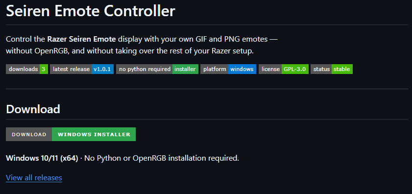

# Seiren Emote Controller

Control the **Razer Seiren Emote** display with your own GIF and PNG emotes —  
without OpenRGB, and without taking over the rest of your Razer setup.

[](https://github.com/EudoksjuszSzalony/Razer-Seiren-Emote-Controller/releases)
[](https://github.com/EudoksjuszSzalony/Razer-Seiren-Emote-Controller/releases/latest)


[](LICENSE)


---

## Download

[](https://github.com/EudoksjuszSzalony/Razer-Seiren-Emote-Controller/releases/latest/download/SeirenEmoteController_Setup_Latest.exe)

**Windows 10/11 (x64)** · No Python or OpenRGB installation required.

[View all releases](https://github.com/EudoksjuszSzalony/Razer-Seiren-Emote-Controller/releases)

---

## What is this?

**Seiren Emote Controller** is a standalone Windows application for the  
**Razer Seiren Emote** microphone.

It lets you:

- play **animated GIFs**
- display **PNG emotes**
- keep using **Razer Synapse / Chroma Studio** for your other devices
- restore your **last played emote** automatically on startup
- run quietly in the **system tray**
- use a **native HID backend** without needing OpenRGB

---

## Features

- ✅ Native **Direct HID** control of the Seiren Emote LED matrix
- ✅ Works alongside **Synapse 3 / Chroma Studio**
- ✅ GIF and PNG playback
- ✅ Adjustable **brightness**
- ✅ Adjustable **animation speed**
- ✅ Easy **display orientation** controls
- ✅ Import Razer Streamer Companion emotes from local cache, or add your own PNG/GIF from the GUI
- ✅ Lightweight automatic media folder refresh
- ✅ Tray mode, persistent checked options, optional animated live emote preview
- ✅ Restore last selected emote on app launch
- ✅ Windows installer with Start Menu integration

---

## Quick Start

### 1. Prepare Streamer Companion (recommended)
If you want the original Razer 8×8 emotes, install **Razer Streamer Companion** and run it at least once to populate its local cache. Seiren Emote Controller can read compatible cached emotes without redistributing Razer assets. The importer is best-effort and depends on the local cache format; you may always use your own PNG/GIF files instead.

### 2. Install and launch
Download the latest Windows installer above. No Python or OpenRGB is required. Launch **Seiren Emote Controller** from Start or tray. There is **no need to click Connect** in normal use — selecting or restoring an emote connects automatically. Connect is still available for manual troubleshooting.

### 3. Get media into your library
- On a fresh empty installation the app **attempts one automatic local Streamer Companion import**, asynchronously, without delaying startup.
- Click **Import Streamer Companion** to import again or choose a custom cache folder.
- Click **Add PNG/GIF** to copy your own images into the library (no Explorer navigation required).
- Click **Open media folder** to open the library in Windows Explorer.
- **Refresh icons** only refreshes visible local media; it does not import from Streamer Companion.

### 4. Play
Click an emote to play it. The gallery also checks file names, sizes and modification dates every **5 seconds**, refreshing only when files change (no continuous GIF decoding or busy polling).

## Tray menu and settings

Right-click the notification-area (system tray) icon to access these settings. A **checkmark means enabled**:

| Option | Description | Default |
| --- | --- | --- |
| Autostart | Start the app when you sign in to Windows | Set by installer or tray |
| Clear display on exit | Send an all-black frame when fully exiting, not when hiding to tray | Off |
| Animated tray | Show a live 8×8 preview of the selected emote instead of the default static icon | Off |

Animated tray updates are throttled to a maximum of **5 FPS** to reduce Windows Explorer/notification-area work. It does not send additional USB HID commands and is independent of microphone playback. Settings persist across launches.

All local media and user settings are stored under `%LOCALAPPDATA%\SeirenEmoteController`. The application does not upload your files anywhere.

---
 
## Screenshots

### Application window · emote library

Browse the 8×8 GIF/PNG collection, search by name, switch animations instantly, and adjust **brightness**, **speed**, and **display orientation**. Import from Streamer Companion or add your own images without leaving the application.

<p align="center">
  <a href="docs/screenshots/main-window.webp"></a>
</p>

### System tray · quick settings

The right-click menu provides three persistent, checkable options: **Autostart**, **Clear display on exit**, and **Animated tray** (a live preview of the current emote). A checkmark means the option is enabled.

<p align="center">
  <a href="docs/screenshots/tray-menu.webp"></a>
</p>

<details>
<summary><strong>Repository badge preview</strong> · release statistics and Windows installer download</summary>

The README header uses repository-hosted copies of the official Shields.io badges. The real counters and release version are updated automatically.

<p align="center">
  <a href="docs/screenshots/readme-header-badges.webp"></a>
</p>
</details>

---
## Why this project?

The goal was to create a **simple, standalone controller** for the  
**Razer Seiren Emote** that:

- does **not** require OpenRGB for normal use
- does **not** break custom Synapse lighting on other devices
- is easy to install for non-technical users
- supports importing and playing emotes in a clean desktop app

---

## Notes

- README badge SVGs are rendered **by Shields.io** and mirrored into this repository by GitHub Actions roughly every six hours. This retains the original Shields design without loading a Shields URL through GitHub Camo on every page view. Download counts reflect GitHub Release asset downloads, not unique users or repository clones.
- A layer-based in-app animation editor is a future idea, **not included** in this branch.

- The installer is currently **not digitally signed**.
  Windows SmartScreen may show a warning before launch.
- **Razer-owned original GIF assets are not redistributed** in this repository or release packages.
- This is an **independent community project** and is **not affiliated with Razer**.

---

## Build from source

Requires **Python 3.11+** (only for running from source, not for the Windows installer).

```powershell
py -m pip install -r requirements.txt
py seiren_emote_gui.py
```

---

## License

Licensed under the **GNU General Public License v3.0 (GPL-3.0)**. See [LICENSE](LICENSE).

