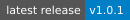
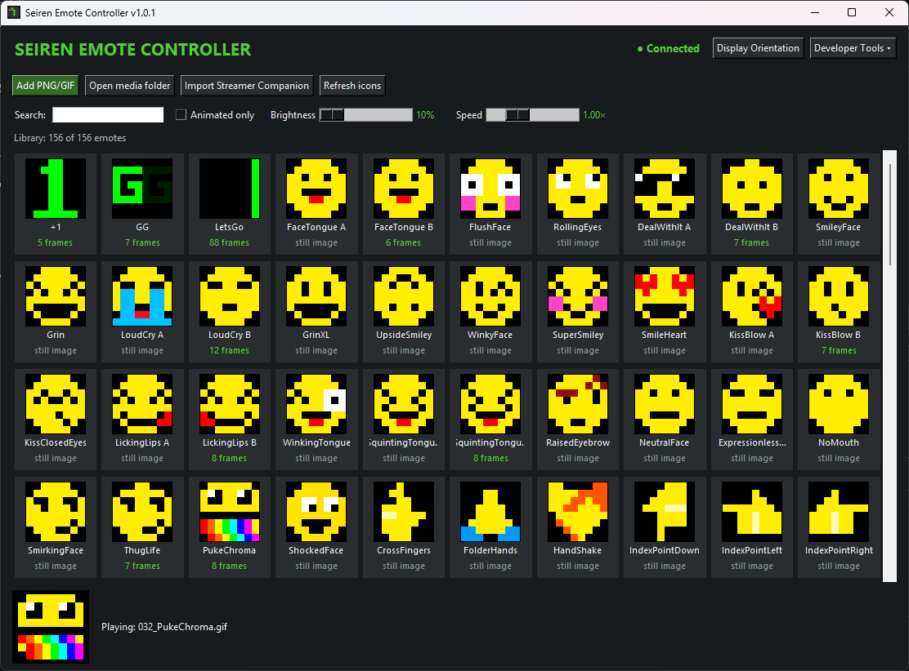
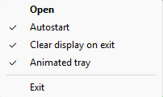

# Seiren Emote Controller

Control the **Razer Seiren Emote** display with your own GIF and PNG emotes —  
without OpenRGB, and without taking over the rest of your Razer setup.

[](https://github.com/EudoksjuszSzalony/Razer-Seiren-Emote-Controller/releases)
[](https://github.com/EudoksjuszSzalony/Razer-Seiren-Emote-Controller/releases/latest)


[](LICENSE)


---

## Download

[](https://github.com/EudoksjuszSzalony/Razer-Seiren-Emote-Controller/releases/latest/download/SeirenEmoteController_Setup_Latest.exe)

**Windows 10/11 (x64)** · No Python or OpenRGB installation required.

[View all releases](https://github.com/EudoksjuszSzalony/Razer-Seiren-Emote-Controller/releases)

---

## What is this?

**Seiren Emote Controller** is a standalone Windows application for the  
**Razer Seiren Emote** microphone.

It lets you:

- play **animated GIFs**
- display **PNG emotes**
- keep using **Razer Synapse / Chroma Studio** for your other devices
- restore your **last played emote** automatically on startup
- run quietly in the **system tray**
- use a **native HID backend** without needing OpenRGB

---

## Features

- ✅ Native **Direct HID** control of the Seiren Emote LED matrix
- ✅ Works alongside **Synapse 3 / Chroma Studio**
- ✅ GIF and PNG playback
- ✅ Adjustable **brightness**
- ✅ Adjustable **animation speed**
- ✅ Easy **display orientation** controls
- ✅ Import Razer Streamer Companion emotes from local cache, or add your own PNG/GIF from the GUI
- ✅ Lightweight automatic media folder refresh
- ✅ Tray mode, persistent checked options, optional animated live emote preview
- ✅ Restore last selected emote on app launch
- ✅ Windows installer with Start Menu integration

---

## Quick Start

### 1. Prepare Streamer Companion (recommended)
To use the original Razer 8×8 emotes, install **Razer Streamer Companion** and run it at least once so its local cache is populated. Seiren Emote Controller can import compatible cached animations, without redistributing proprietary assets. You can also use your own PNG/GIF images instead.

### 2. Install and launch
Download the **Windows installer** at the top of this page and run it. **Python and OpenRGB are not required.** Start Seiren Emote Controller from the Start Menu or system tray.

**No need to press Connect** in normal use: selecting or restoring an emote connects automatically. The manual connection control lives under **Developer Tools**.

**Application window · emote library**

Browse and search your emotes; adjust brightness or playback speed, filter animated images, and manage PNG/GIF files without leaving the program.

[](docs/screenshots/main-window.webp)

### 3. Get emotes into your library
- On a fresh, empty installation, the app tries to import the **local Streamer Companion cache** automatically in the background.
- **Import Streamer Companion** lets you retry that operation or select a custom cache directory.
- **Add PNG/GIF** copies your own images into the library.
- **Open media folder** opens the library in Windows Explorer.
- **Refresh icons** only refreshes the local gallery; it does not reimport assets.

New or removed media files are detected automatically about every **5 seconds**, using lightweight file metadata checks.

### 4. Optional: Set display orientation
If the pattern on the physical microphone does not match the preview, select **Display Orientation**, choose the correct rotation/mirror setting and click **Apply**. You generally only need to calibrate once.

[](docs/screenshots/orientation.png)

### 5. Play
Select any emote in the library to show it on the microphone. The app restores your last played emote when you launch it again.

### System tray · quick settings
The system tray icon keeps the controller accessible when its window is hidden. Right-click it to open the settings menu:

[](docs/screenshots/tray-menu.webp)

A **checkmark means enabled**:

| Option | What it does | Default |
| --- | --- | --- |
| **Autostart** | Launch the app automatically when you sign in to Windows | Set by the installer or Tray |
| **Clear display on exit** | Clear the microphone matrix when fully exiting, but not when merely hiding the window | Off |
| **Animated tray** | Show a live preview of the playing 8×8 emote rather than the static app icon | Off |

The optional animated Tray refreshes at **up to 5 FPS**, without issuing extra USB commands. These settings persist across restarts. There is no separate tray tooltip setting.

### Developer Tools (optional)
Click **Developer Tools** in the main window to reveal **Backend**, **Connect**, and **Stop** for manual troubleshooting. The controls are hidden by default so everyday playback remains simple; no manual connection is required.

All local media and user settings are stored under `%LOCALAPPDATA%\\SeirenEmoteController`. The application does not upload your files.

---
## Why this project?

The goal was to create a **simple, standalone controller** for the  
**Razer Seiren Emote** that:

- does **not** require OpenRGB for normal use
- does **not** break custom Synapse lighting on other devices
- is easy to install for non-technical users
- supports importing and playing emotes in a clean desktop app

---

## Notes

- README badge SVGs are rendered **by Shields.io** and mirrored into this repository by GitHub Actions roughly every six hours. This retains the original Shields design without loading a Shields URL through GitHub Camo on every page view. Download counts reflect GitHub Release asset downloads, not unique users or repository clones.
- A layer-based in-app animation editor is a future idea, **not included** in this branch.

- The installer is currently **not digitally signed**.
  Windows SmartScreen may show a warning before launch.
- **Razer-owned original GIF assets are not redistributed** in this repository or release packages.
- This is an **independent community project** and is **not affiliated with Razer**.

---

## Build from source — ONLY FOR DEVELOPERS

**End users: do not run these commands.** Install the ready-to-use Windows application from the [Download](#download) section instead.\n\nThe steps below are only for developers running or modifying the source code. Requires **Python 3.11+**.

```powershell
py -m pip install -r requirements.txt
py seiren_emote_gui.py
```

---

## License

Licensed under the **GNU General Public License v3.0 (GPL-3.0)**. See [LICENSE](LICENSE).

